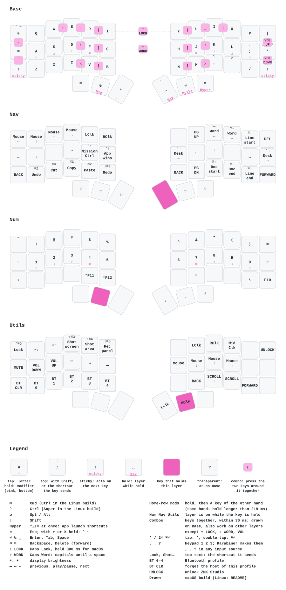

# CORNE ZMK

ZMK (`main`, Zephyr 4.1) for Corne on nice!nano v2, with a dongle
(nice!nano or XIAO BLE) or without one. Keymap is editable live in
[ZMK Studio](https://zmk.studio).

## Principle: everything in the firmware, the computer stays default

The keyboard is meant to work on a computer with default settings: stock input
sources (ABC, Russian – PC), stock system shortcuts, no key remapping in the
OS. Every key, combo, modifier position and shortcut is defined in
`config/corne.keymap`, and the keymap sends the shortcuts the OS already
knows (e.g. Cmd+Shift+4 for a screenshot) instead of relying on custom ones.

Host-side setup is the exception and is allowed only when the firmware cannot
do it. Each exception is listed here, kept in this repo and applied by a script:

- macOS, punctuation in any input source: Karabiner-Elements (see
  [below](#macos-punctuation-in-any-input-source)). The keyboard cannot know the
  active input source, so it cannot pick the key for `.` or `,`.
- macOS, switching the input source: the `E`+`I` combo sends F18, Karabiner
  turns it into the Globe key. macOS ignores the consumer usage that stands
  for Globe on other keyboards (0x029D), so the firmware cannot send it.
- AeroSpace cheat sheet (macOS): the combo of the two outer sticky Shift keys
  sends F20, AeroSpace binds it in `~/.aerospace.toml` to a script from the
  dotfiles repo. The firmware cannot open a window.
- App launch shortcuts: the keymap sends a fixed chord (Hyper+letter), the OS
  binds it to an app (see [App launch](#app-launch-hyper)). The firmware cannot
  start programs.
- Cmd+C interrupts and Cmd+W deletes a word in terminals (macOS): VS Code keybindings and Karabiner
  rules for Terminal.app. The firmware does not know the app, the focus or the
  selection (see [below](#macos-cmdc-interrupts-in-terminals)).

## Target OS: one keymap, a build per OS

Shortcuts differ between systems (Cmd vs Ctrl, screenshots, lock), so the
central part (dongle, or left half without a dongle) is built for one OS:
`build.yaml` passes `-DOS_MAC` or `-DOS_LINUX` (GNOME) to the keymap, and the
"Target OS" block at the top of `config/corne.keymap` defines everything that
differs. The layers use only those names. A build without the flag fails.
Halves have one build for both systems. To switch OS, reflash the central part.

Modifiers are named by role:

| Role | macOS | Linux | Keys |
|---|---|---|---|
| `SC`, shortcut modifier (copy, paste, save) | Cmd | Ctrl | A, ; (hold, pinkies), left thumb, outer left key |
| `OT`, the other one | Ctrl | Super | F, J (hold, index fingers) |

So copy is the same physical chord on both systems (`SC`+C), and nothing is
remapped in the OS.

Pressing chords (each is a test in `tests/cases/shortcut-*.test`):

- Hold a home-row modifier and press a key of the **other hand** or **any
  thumb key**: ;+C is `SC`+C at once, A+Tab thumb is `SC`+Tab (app switch with
  pinky and thumb), ;+Backspace thumb is `SC`+Backspace. With a letter of the
  same hand (A+C) a fast roll types the letters; hold the modifier longer than
  219 ms first, or use a thumb. A roll into a thumb key (A then Enter, released
  in order) still types the letter.
- Left thumb `SC` is a plain key, it works with anything: thumb+C, thumb+Tab,
  thumb+Space.
- `SC`+Shift+C (Cmd+Shift+C on macOS): hold the left thumb, tap the outer
  left Shift (sticky) or hold it, press C. Or hold ;, then K, press C.
- Shift and Alt on home row: K / D (Shift), L / S (Alt), hold + key of the other hand.

### System keys: how they work

The keyboard has no custom shortcuts and nothing in the OS is bound for it.
Each system key sends one of two things:

- a **consumer key** (volume, media, brightness): a separate HID usage, like
  the media keys of any keyboard. The OS acts on it directly, no shortcut or
  setting is involved.
- the **OS default shortcut** for the action (screenshot, lock, Mission
  Control, desktops): the names in the "Target OS" block of
  `config/corne.keymap` (`SHOT_AREA`, `LOCK`, `DESK_PREV`…) are defined as
  macOS shortcuts in the `-mac` build and as GNOME ones in the `-linux` build,
  so the same physical key does the same thing on both systems.

So if a key stops working, check that its shortcut is still enabled in the OS
(column "macOS setting").

| Action | Key | macOS sends | macOS setting | Linux (GNOME) sends |
|---|---|---|---|---|
| Volume + / − | combo `[`+`'` / `'`+right Shift; or Utils + S / A | consumer `C_VOL_UP` / `C_VOL_DN` | none | same |
| Mute | Utils + outer left (`⌘` key) | consumer `C_MUTE` | none | same |
| Previous / play-pause / next | Utils + D / F / G | consumer keys | none | same |
| Display brightness − / + | Utils + Q / W | consumer `C_BRI_DN` / `C_BRI_UP` | none | same |
| Lock screen | Utils + Esc | ⌃⌘Q | Apple menu, fixed | Super+L |
| Screenshot: screen | Utils + E | ⇧⌘3 | Keyboard Shortcuts → Screenshots | Shift+Print |
| Screenshot: area | Utils + R | ⇧⌘4 | Keyboard Shortcuts → Screenshots | Print (screenshot UI) |
| Screenshot panel, screen recording | Utils + T | ⇧⌘5 | Keyboard Shortcuts → Screenshots | Ctrl+Alt+Shift+R |
| Mission Control / overview | Nav + F | ⌃↑ | Keyboard Shortcuts → Mission Control | Super |
| App windows (App Exposé) | Nav + G | ⌃↓ | Keyboard Shortcuts → Mission Control | Super+A (app grid) |
| Previous / next desktop | Nav + `;` / `'` (after the arrows) | ⌃← / ⌃→ | Keyboard Shortcuts → Mission Control → Mission Control → Move left / right a space | Ctrl+Alt+← / → |
| Undo, cut, copy, paste, redo | Nav + Z X C V B | ⌘Z ⌘X ⌘C ⌘V ⇧⌘Z | app standard | Ctrl+Z… / Ctrl+Shift+Z |
| Arrows | Nav + H J K L (← ↓ ↑ →, as in vim), also left hand Ctrl-key A S D | arrows | none | same |
| Page up / down | Nav + U / M | PgUp / PgDn | none | same |
| Word left / right | Nav + I / O | ⌥← / ⌥→ | text standard | Ctrl+← / → |
| Line start / end | Nav + P / `/` | ⌘← / ⌘→ | text standard | Home / End |
| Document start / end | Nav + `,` / `.` | ⌘↑ / ⌘↓ | text standard | Ctrl+Home / End |
| Delete forward | Nav + `[` | Del | none | same |
| Hyper (app launch, AeroSpace) | hold Del thumb (right) or Enter thumb (left; tap = Enter) | ⌃⌥⇧⌘ + letter | Shortcuts app, see below | Ctrl+Alt+Shift+Super |
| `,` `.` `?` | Num + right thumbs | keypad 1 2 3 | Karabiner, see below | keypad 1 2 3 |
| Caps Lock | combo T+Y (after a 150 ms pause in typing) | Caps Lock held 300 ms | none | same |
| Caps word | combo G+H (after a 150 ms pause in typing) | letters in capitals until Space | none | same |
| Switch input source | combo `E`+`I` (after a 150 ms pause in typing) | F18, Karabiner turns it into the Globe key (see [below](#macos-punctuation-in-any-input-source)) | Keyboard → "Press 🌐 key to" → Change Input Source | Super+Space |
| AeroSpace cheat sheet | combo of the two outer sticky Shift keys (bottom row) | F20, AeroSpace runs `aerospace-cheatsheet.sh` from the dotfiles repo | binding `f20` in `~/.aerospace.toml` | nothing bound |

"Keyboard Shortcuts" is System Settings → Keyboard → Keyboard Shortcuts…
Utils is held on the Backspace thumb, Nav on the Space thumb, Num on the Tab
thumb. The keymap picture shows each of these keys with the shortcut it sends
in small text on top.

On this Mac (checked 2026-11-19) all of these shortcuts are at the macOS
defaults; "Move left / right a space" are set explicitly and enabled. There
are no app-specific shortcuts (`NSUserKeyEquivalents`).

Since then the tiling window manager AeroSpace (config in the dotfiles repo,
`.aerospace.toml`) is installed and uses the keyboard in two ways. Hyper+letter
bindings drive its workspaces, windows and modes. It also intercepts ⌃←/→/↑/↓, which
the Nav layer sends on `;` `'` `F` `G`: they now switch to the previous / next
AeroSpace workspace, make the window fullscreen and float it, instead of macOS
Spaces, Mission Control and App Exposé (real Ctrl+arrows in apps no longer
arrive). The firmware is unchanged.

The MacBook keyboard backlight has no HID usage for an external keyboard: use
Control Center. F1–F12 are plain F-keys on both systems (macOS applies the
"F1, F2 as standard keys" setting to Apple keyboards only); media and
brightness are separate consumer keys, so no Fn key is needed.

### App launch: Hyper

Hold the Del thumb (right) or the Enter thumb (left) and press a letter, so the
letters of both halves are reachable: Hyper+letter is free on both systems.
Bind it in the OS:

- macOS: Shortcuts app → new shortcut → action "Open App" → shortcut details
  (ⓘ) → "Add Keyboard Shortcut" → press Hyper+letter.
- GNOME: Settings → Keyboard → View and Customize Shortcuts → Custom
  Shortcuts → `+`, command e.g. `gnome-terminal`, press Hyper+letter.

Keep the bindings you set up listed here, so they can be restored on a new
machine.

### Moving a Mac to the macOS build

Earlier builds sent Linux modifiers and relied on a Ctrl ↔ Cmd swap in macOS.
After flashing the `-mac` central:

1. System Settings → Keyboard → Keyboard Shortcuts → Modifier Keys → select
   Corne → "Restore Defaults".
2. `scripts/karabiner-setup.sh`: removes the swap from Karabiner too.



**Show it from the keyboard:** press the outer keys of the middle row together
(left ⌘ key + right `'` key, Base layer); press them again to hide it. The
combo sends F19, unused on both systems, and the OS runs
`scripts/keymap-view.sh toggle`:

- macOS: Karabiner rule `macos/karabiner/corne-keymap-view.json` (installed by
  `scripts/karabiner-setup.sh`). The picture opens in `~/Applications/KeymapView.app`
  (`scripts/keymap-view.swift`, built by the setup), in front of other windows
  and focused; Esc or Cmd+W also closes it. Quick Look is not used: started
  from the background it opens without focus. The viewer draws the SVG with
  WebKit, as a browser does. With AeroSpace (dotfiles repo) the window stays
  floating on the current workspace: the script moves it there and gives the
  focus back, and closing it does not jump to another workspace.
- GNOME: Settings → Keyboard → View and Customize Shortcuts → Custom
  Shortcuts → `+`, command `<repo>/scripts/keymap-view.sh`, shortcut: press the
  combo. The picture opens in the image viewer (Loupe or eog).

The picture is rendered locally with [keymap-drawer](https://github.com/caksoylar/keymap-drawer)
(version pinned in the script, runs in Docker if not installed) and committed
together with the keymap. CI does not draw or check it. It shows the macOS
build; the legend at the bottom explains the marks (hold, shifted / shortcut,
sticky, layer keys, combos) and the symbols.

- Labels: `img/keymap-img/keymap_drawer.config.yaml`, `raw_binding_map` for
  whole bindings (`&caps_lock`, `&kp LG(LS(N4))` → "Shot area" with "⇧⌘4" on
  top), `zmk_keycode_map` for key codes.
- `scripts/keymap_legend.py` post-processes the SVG: keymap-drawer has no
  legend and draws every combo on every layer, so the script keeps combos on
  Base only and appends the legend (its text is in the script).

```sh
scripts/draw-keymap.sh           # updates img/keymap-img/corne.{yaml,svg}
scripts/draw-keymap.sh --check   # fails if the images are outdated
git config core.hooksPath .githooks   # once per clone: pre-commit hook re-renders
                                      # and stages the images when the keymap, the drawer
                                      # config, scripts/keymap_legend.py or draw-keymap.sh is
                                      # committed; it also warns when the Studio reference
                                      # was not taken from this keymap
```

The pre-push hook (`.githooks/pre-push`) runs `scripts/draw-keymap.sh --check` and stops
the push if the picture is outdated (needs Docker or keymap-drawer; without them it only
warns), and repeats the Studio reference warning.

If a global `core.hooksPath` dispatches to `.git/hooks/<name>`, link the hooks
there instead, so the global hooks keep working:
`ln -s ../../.githooks/pre-commit .git/hooks/pre-commit` and
`ln -s ../../.githooks/pre-push .git/hooks/pre-push`.

## Setups: with or without the dongle

| Setup | Central (talks to the computer, runs the keymap and Studio) | Peripherals |
|---|---|---|
| `dongle` | dongle on USB (nice!nano or XIAO BLE) | left and right half over BLE |
| `no-dongle` | left half, over USB or Bluetooth | right half over BLE |

The split role is compiled into the firmware (Kconfig), so the setup is
switched by flashing, not by a key. The right half has the same firmware in
both setups; the left half (and the dongle) change. A half keeps its pairing
with the old central, so switching needs a settings reset on every part:
`flash-all.sh` remembers the setup it flashed last (`.git/corne-flashed-mode`)
and turns `--reset` on by itself when the setup changes. Without the dongle,
unplug it: a powered dongle would take the right half back. The left half drains
its battery faster without the dongle: it keeps both the computer and the
right half connected.

Setups, boards and OSes are described once in `scripts/firmware.py`:
`build.yaml` is generated from it (`scripts/firmware.py gen`; the pre-commit
hook does it and CI checks it), and local builds and flashing pick the parts
of a setup from it. To add a setup (e.g. right half as central), add a shield
under `config/boards/shields/corne/` (key pins are in `corne_left.dtsi` /
`corne_right.dtsi`) and an entry in `MODES`.

## Battery and sleep

Halves go to deep sleep after a time without key presses
(`CONFIG_ZMK_SLEEP`, `CONFIG_ZMK_IDLE_SLEEP_TIMEOUT` in the shield `.conf`
files). A key press wakes the half: the key matrix is a `wakeup-source`
(`corne.dtsi`), the half reboots and reconnects in a second or two, the waking
key press is not typed. The dongle is on USB and never sleeps.

| Part | Sleeps after | Counts key presses of |
|---|---|---|
| left half as central (no dongle) | 10 min | both halves |
| peripheral halves (right; both with the dongle) | 30 min | itself only |

ZMK counts activity per part: a peripheral sees only its own keys, so typing
with the other hand alone does not keep it awake (there is no activity sync
between halves). The peripherals' longer timeout covers one-handed typing; if
a half did fall asleep, its first key press only wakes it.

To check sleep without waiting 10 minutes, build with a 1 minute timeout and
watch the Bluetooth connection (the left half disconnects when it sleeps):

```sh
scripts/zmk-docker.sh build --mode no-dongle --os mac --cmake-arg=-DCONFIG_ZMK_IDLE_SLEEP_TIMEOUT=60000
scripts/flash.sh central-left mac && scripts/flash.sh right
scripts/sleep-watch.sh      # "12:01:05 not connected (was connected for 60 s)"
# press a key on the left half: "connected" again in a few seconds
scripts/zmk-docker.sh build --mode no-dongle --os mac   # then flash the normal build back
```

`--cmake-arg` passes any CMake argument to every target, so any Kconfig option
can be overridden for a test build. The file names stay the same; each `.uf2`
gets a `.info` next to it (commit, date, sleep setting, extra arguments), and
`flash.sh` prints it before flashing, with a red warning for a test build:

```text
  built:  2026-11-19 08:50 UTC
  commit: 8cf486d (battery-sleep)
  sleep:  after 1 min without key presses
  extra:  -DCONFIG_ZMK_IDLE_SLEEP_TIMEOUT=60000
  TEST BUILD: extra CMake arguments, rebuild without --cmake-arg for normal use
  !!! ТЕСТОВАЯ СБОРКА (--cmake-arg), не для обычной работы
```

`scripts/battery.sh` prints the battery level of each half (no-dongle setup:
the left half is the Bluetooth device, it sends its own level and proxies the
right half's one, `..._BATTERY_LEVEL_FETCHING` / `_PROXY` in
`config/corne.conf`). With the dongle on USB there is nothing to read.

macOS does not show it anywhere: it takes a keyboard's battery only from HID
reports and ignores the Bluetooth Battery Service that ZMK uses. The script
reads that service with CoreBluetooth (`scripts/battery-mac.swift`, run by
`swift`, Command Line Tools); the first run asks to allow Bluetooth for the
terminal app. On Linux `upower` reads it.

```text
$ scripts/battery.sh
left half : 56%
right half: 73%
```

### Menu bar indicator (macOS)

The menu bar shows `⌨ 57·74`: left half · right half, in %. `⌨ 57·zz`: the
right half is asleep (not connected to the left one); `⌨ zz`: the whole
keyboard is asleep or off. The dropdown has both levels, the time of the read
(or of the last read while asleep), "Refresh" and a link to the Bluetooth
settings. Below 20 % the title turns red and one notification comes (again only
after the half was charged above 20 %); a sleeping half does not count as low.

The halves sleep on their own timers, and the indicator follows each of them
at once, without polling:

| Event | Seen through | Menu bar |
|---|---|---|
| left half wakes up / connects to the Mac | IOKit: a Corne HID device appears | reader starts, levels in ~3 s |
| left half falls asleep | IOKit: the device goes away | `⌨ zz` |
| right half wakes up / falls asleep | the left half sends a battery notification (right = 0 while it is not connected) | `57·74` / `57·zz` |
| a level changes | battery notification | new value |

Every 2 minutes (5 while asleep) the plugin also checks that the reader runs.
Reading does not count as key activity: it does not keep the halves awake.

How it works:

- [SwiftBar](https://github.com/swiftbar/SwiftBar) shows the output of plugin
  scripts from its plugin folder: the first line in the menu bar, lines after
  `---` in the dropdown, `| color=… refresh=… href=…` set the look and actions.
  `macos/swiftbar/corne-battery.sh` is a *streamable* plugin
  (`<swiftbar.type>streamable</swiftbar.type>`): it runs all the time and each
  `~~~` line replaces the menu with what follows.
- Two programs write events into one FIFO the plugin reads:
  - `corne-watch` (`scripts/corne-watch.swift`): IOKit notifications when the
    Corne (VID 0x1D50, PID 0x615E) appears or goes away as a HID device, plus
    timer ticks; needs no permission.
  - `CorneBattery.app --watch` (`scripts/battery-mac.swift`): connects to the
    left half, subscribes to the Battery Level notifications (its own and the
    proxied right half's) and prints `levels <left> <right>` on each change;
    exits when the left half disconnects.
- SwiftBar has no Bluetooth permission, and macOS kills a process it starts
  that uses Bluetooth. So the reader is compiled into
  `~/Applications/CorneBattery.app`, a background app (no Dock icon) with its
  own permission; the plugin starts it with `open`.
- The plugin folder is `~/.config/swiftbar`; it holds a link to the plugin in
  the repo, so edits apply on the next "Refresh" (it restarts the plugin).

Everything is done with `scripts/swiftbar.sh`:

```sh
scripts/swiftbar.sh install     # SwiftBar, CorneBattery.app, plugin link, start SwiftBar
scripts/swiftbar.sh status      # installed / running / linked / built / Bluetooth allowed + plugin output
scripts/swiftbar.sh show        # run the plugin here: what the menu bar shows
scripts/swiftbar.sh refresh     # refresh the menu bar item now
scripts/swiftbar.sh rebuild     # rebuild after editing battery-mac.swift / corne-watch.swift
scripts/swiftbar.sh start|stop  # start / quit SwiftBar
scripts/swiftbar.sh autostart [on|off]  # start SwiftBar at login; no argument: show the state
scripts/swiftbar.sh uninstall [--all]   # --all: also SwiftBar and its settings
```

`install` installs SwiftBar with Homebrew into `~/Applications` (no sudo), builds and
signs (ad hoc) `CorneBattery.app` (only if its source changed), builds `corne-watch`, sets the plugin folder if SwiftBar has none,
links the plugin, starts SwiftBar and turns on autostart. Then allow
Bluetooth for "CorneBattery" when macOS asks (or System Settings → Privacy &
Security → Bluetooth).

Autostart is a LaunchAgent, `~/Library/LaunchAgents/local.corne.swiftbar.plist`:
at login it runs `open -g -a SwiftBar`. macOS shows it in System Settings →
General → Login Items & Extensions → "Allow in the Background" (as `open`); the
switch there turns it off too. SwiftBar's own "Launch at Login" is not needed
(both together do no harm).

Maintain:

| Task | How |
|---|---|
| Changed `battery-mac.swift` / `corne-watch.swift` | `scripts/swiftbar.sh rebuild`; a rebuilt CorneBattery.app has a new ad-hoc signature, so macOS asks for Bluetooth again (until then: `timeout … waiting for Bluetooth`) |
| Changed the plugin | nothing, it is a link; `scripts/swiftbar.sh refresh` to see it now |
| Other intervals | `TICK_S`, `ASLEEP_TICK_S`, `SETTLE` in the plugin, then "Refresh" |
| Other threshold | `LOW=` in the plugin |
| Update SwiftBar | its own updater (SwiftBar → Check for Updates), or `brew upgrade --cask swiftbar` |
| Check everything | `scripts/swiftbar.sh status` |

Troubleshooting (what the menu bar shows):

| Title | Dropdown says | Fix |
|---|---|---|
| `⌨ zz` | Corne not connected: asleep or off | press a key; with the dongle there is no Bluetooth battery to read |
| `⌨ –` | no Bluetooth access | System Settings → Privacy & Security → Bluetooth → CorneBattery on |
| `⌨ –` | timeout after 15 s | the left half is reconnecting after sleep: "Refresh" in a few seconds |
| `⌨ –` | timeout … waiting for Bluetooth | CorneBattery was rebuilt: answer the Bluetooth prompt, or switch it off and on in Privacy & Security → Bluetooth |
| `⌨ ?` | CorneBattery.app or corne-watch is missing | `scripts/swiftbar.sh install` |
| no `⌨` at all | | `scripts/swiftbar.sh status`: SwiftBar not running or plugin not linked |

Remove: `scripts/swiftbar.sh uninstall` (plugin link, CorneBattery.app, its
Bluetooth permission), `uninstall --all` also removes SwiftBar and its settings.

## Firmware

GitHub Actions (or `scripts/zmk-docker.sh build` locally, into `firmware/`) builds:

| Setup | Part | File |
|---|---|---|
| dongle | dongle (nice!nano) | `corne_central_dongle-nice_nano_zmk-{mac,linux}.uf2` |
| dongle | dongle (XIAO BLE) | `corne_central_dongle-xiao_ble_zmk-{mac,linux}.uf2` |
| dongle | left / right half | `corne_peripheral_left-…`, `corne_peripheral_right-…` |
| no dongle | left half (central) / right half | `corne_central_left-nice_nano_zmk-{mac,linux}.uf2`, `corne_peripheral_right-…` |
| any | clear bonds and settings | `settings_reset-…` |

The central part has a file per OS (see [Target OS](#target-os-one-keymap-a-build-per-os)).

Flash all parts from the same build: the split protocol between dongle and
halves must match. Each part is flashed separately over USB: double-tap reset,
the part shows up as a UF2 drive (`NICENANO`, `XIAO-SENSE`), copy the `.uf2`
onto it, the part reboots.

```sh
scripts/zmk-docker.sh build --mode no-dongle --os mac --reset   # only the parts of one setup
scripts/firmware.py list --mode no-dongle --os mac             # which files that is

scripts/flash-all.sh                    # guided: dongle, left, right, then Studio check
scripts/flash-all.sh --mode no-dongle   # left as central, right (also: --no-dongle)
scripts/flash-all.sh --os linux         # central for this OS (default: the OS of this computer)
scripts/flash-all.sh --reset            # settings_reset before each part (halves don't pair)
scripts/flash-all.sh --no-reset         # no automatic reset when the setup changes
scripts/flash.sh dongle|central-left mac|linux   # one central part
scripts/flash.sh left|right|reset                # one half, or settings reset
```

`flash.sh` waits for the drive, picks the file by board (`INFO_UF2.TXT`),
copies it and waits for the drive to disappear. `flash-all.sh` prompts for
each part, refuses to start a step while another part is still in the
bootloader, and at the end reads the keymap over Studio and compares it with
`tests/hardware/keymap.<os>.txt` (saves it on the first run). Left and right halves are not distinguishable by
the script: connect the one it asks for.

### Bootloader key

The keymap has no `&bootloader` key. If one is added back, note that it runs
on the part where the key is pressed (ZMK "event source" locality): a key on
the left half puts the **left half** into the bootloader, never the dongle.
The dongle only enters the bootloader by double-tapping its reset.

## macOS: punctuation in any input source

The keyboard sends key codes, the input source turns them into characters, so
`,` `.` `?` sit on different keys in ABC and Russian – PC. The thumb keys of the
Num layer send keypad `1` `2` `3` (`KP_N1..3`), and
[Karabiner-Elements](https://karabiner-elements.pqrs.org) turns them into
`,` `.` `?` for the current input source. On other systems they stay keypad digits.

```sh
scripts/karabiner-setup.sh --diff   # what would change in ~/.config/karabiner/karabiner.json
scripts/karabiner-setup.sh          # apply (backup first) and start Karabiner
```

Karabiner is configured by `~/.config/karabiner/karabiner.json`, which it
reloads on save. The script changes only the Corne entries there, the rest stays:

- only the Corne is grabbed, the built-in keyboard is ignored;
- virtual keyboard type `ansi` (with `iso` macOS swaps `` ` ~ `` and `§ ±`);
- F1–F12 stay F-keys;
- no modifier remaps: the macOS build already has Cmd and Ctrl in place;
- rules from `macos/karabiner/*.json` (descriptions start with `Corne:`).

To change the characters or add an input source, edit
[macos/karabiner/corne-punctuation.json](macos/karabiner/corne-punctuation.json)
(key names: Karabiner-EventViewer) and run the script again.

## macOS: Cmd+C interrupts in terminals

Ctrl+C (SIGINT) is J+C (Ctrl is on the index fingers), but Cmd+C is the
habit. In terminals Cmd+C interrupts, everywhere else it copies as usual:

| Where | Cmd+C | Copy | Set up by |
|---|---|---|---|
| VS Code / Cursor terminal | Ctrl+C when nothing is selected | Cmd+C with a selection | `scripts/vscode-setup.sh` |
| VS Code / Cursor editor, other apps | copy | Cmd+C | nothing to set |
| Terminal.app | Ctrl+C | Cmd+Shift+C | `scripts/karabiner-setup.sh` |

- VS Code / Cursor: `macos/vscode/keybindings.json`, a keybinding with
  `"when": "terminalFocus && !terminalTextSelected"`. Only the editor knows
  the focus and the selection, so this lives in its user `keybindings.json`;
  the script appends missing entries, keeps the rest, makes a backup
  (`--diff` shows the change). It applies to every keyboard.
- Terminal.app cannot tell whether text is selected: Karabiner rule
  `macos/karabiner/corne-terminal-sigint.json`, Corne only, Terminal.app only:
  Cmd+C = Ctrl+C, Cmd+Shift+C = copy (as Ctrl+Shift+C in Linux terminals).

Cmd+W works the same way: in terminals it is Ctrl+W (delete the word before the
cursor, as in Linux terminals) and does not close the window or tab; everywhere
else Cmd+W closes as usual.

| Where | Cmd+W | Set up by |
|---|---|---|
| VS Code / Cursor terminal | Ctrl+W (`"when": "terminalFocus"`) | `scripts/vscode-setup.sh` |
| VS Code / Cursor editor, other apps | close the tab / window | nothing to set |
| Terminal.app | Ctrl+W, Corne only: `macos/karabiner/corne-terminal-delete-word.json` | `scripts/karabiner-setup.sh` |

## Terminal: Shift+arrows select in the command line (zsh)

Terminals send Shift+← as `ESC [1;2D`; plain zsh has nothing bound to it and
prints `;2D` or, in vi mode, deletes text. [zsh-shift-select](https://github.com/jirutka/zsh-shift-select)
binds the Shift keys like an editor; `scripts/zsh-setup.sh` clones it (pinned
commit) into `~/.local/share/zsh-shift-select` and adds a marked block to
`~/.zshrc` with `bindkey -e` (the plugin needs the emacs keymap; `EDITOR=vim`
can start zsh in vi mode).

| Keys | Does |
|---|---|
| Shift+← → ↑ ↓ | select by character / line |
| Shift+Home / End | select to the start / end of the line |
| Shift+Opt+← → (Nav: Shift + word keys) | select by word |
| Backspace / Delete | delete the selection; typing replaces it |
| Opt+W, then Ctrl+Y | copy the selection to the zsh kill buffer, paste it |

This is the line editor's selection, not the terminal's: Cmd+C does not copy
it. If a key does nothing, run `cat` and press it: no output means the
terminal took the key itself.

## ZMK Studio

Studio runs on the central part (dongle, or left half without a dongle), over USB.

1. Connect the central by USB.
2. Open <https://zmk.studio> in Chrome/Edge (Safari has no WebSerial), or the
   desktop app from [zmk-studio releases](https://github.com/zmkfirmware/zmk-studio/releases)
   (`.dmg` for macOS).
   Linux: `.deb` from the same page, then "ZMK Studio" in the app menu.
   Only one client can hold the serial port: close the others first
   (`lsof /dev/ttyACM0` shows who holds it).
3. Unlock: `Utils` layer (hold BSPC thumb) + top-right key (`&studio_unlock`).
   Studio locks again on USB disconnect or after 10 minutes idle.
4. Edit keys and layers, then **Save**. Changes live in the keyboard flash and
   override `config/corne.keymap` until "Restore Stock Settings".

Two empty layers (`extra1`, `extra2`, `status = "reserved"`) are reserved in
the keymap for Studio: add them with `+` in the layer list.

Studio edits bindings and layers only. Combos, macros, tap-dance and
home-row-mod behaviors are defined in `config/corne.keymap` and can be
assigned to keys in Studio.

Linux: the serial port needs user access. Install the udev rule once:

```sh
sudo cp scripts/udev/70-zmk-studio.rules /etc/udev/rules.d/ && sudo udevadm control --reload-rules
```

Check that the keyboard answers Studio and reports the expected keymap
(read-only; needs `pyserial`):

```sh
scripts/studio_check.py                  # print layers read from the keyboard
scripts/studio_check.py --check tests/hardware/keymap.mac.txt   # diff against the reference dump
```

`tests/hardware/keymap.<os>.txt` is the keymap read from the keyboard flashed
with that OS build. Its first line, `# keymap: <blob>`, is the git blob of
`config/corne.keymap` it was taken from, so on a mismatch the script says
which case it is (exit code 2):

| Reference taken from | Means | Do |
|---|---|---|
| another keymap (blob differs) | the keymap changed since; expected | check that the diff is your change, then refresh: `scripts/flash-all.sh --check-only --update-ref`, commit the file |
| the same keymap | the keyboard runs another build, or keys were changed in Studio | flash the current build (compare `firmware/*.info`), or Studio → "Restore Stock Settings" |

Exit code 1 is a real problem: no Studio answer, wrong layers or key count.
`scripts/flash-all.sh --check-only` runs only this check, without flashing.

## Keymap tests

`tests/cases/*.test` script key presses on the real `config/corne.keymap` and
list the expected HID output. The firmware is compiled for ZMK's `native_sim`
board with a mock key matrix and runs as a Linux process: no keyboard and no
host OS involved.

```text
# Удержание A (OT: Super на Linux, Ctrl на Mac) + клавиша правой руки
press A
wait 300
tap H
release A
---
press OT
press H
release H
release OT
```

- Script: `press|release|tap <key>`, `wait <ms>` (gap after the previous
  event, default 10 ms). Key names are base-layer legends, thumbs are `T1`–`T6`
  (see `POSITIONS` in `tests/run_tests.py`).
- Expected: `press|release <usage> [MODS]`, `mouse <buttons>`.
- `after>=<ms>` at the end of an expected line: the event comes at least that
  long after the previous one (e.g. `release CAPS after>=300`, how long a key
  is held).
- Each case runs for both OS builds (`-DOS_MAC`, `-DOS_LINUX`). Modifiers in
  the expected block can be roles: `SC`/`SC_R`, `OT`/`OT_R` (see
  [Target OS](#target-os-one-keymap-a-build-per-os)); concrete names
  (`LCTRL`) are compared as written.
- `@os mac` or `@os linux` in a comment runs a case for one OS only: for keys
  whose output differs beyond the roles (screenshots, lock).
- `@xfail` in a comment marks a known issue.

```sh
scripts/zmk-docker.sh update        # once: fetch ZMK/Zephyr into a Docker volume
scripts/zmk-docker.sh test          # all cases; `test hrm combo` filters by name
ACCEPT=1 scripts/zmk-docker.sh test NAME   # write actual output as expected
```

CI runs the tests before building firmware.
