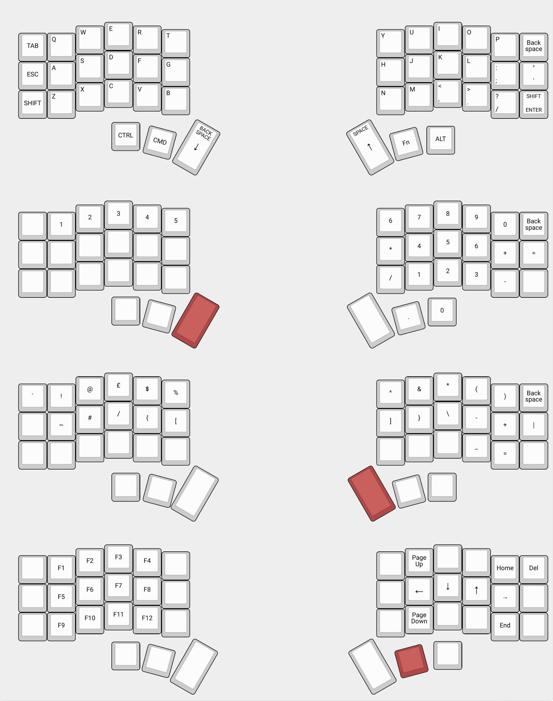

# TODO

## macOS

Прошивка одна для всех ОС, отдельной прошивки под Mac не нужно: клавиатура не
знает, к какой системе подключена.

- [ ] Поставить ZMK Studio на Mac (`.dmg` из релизов zmk-studio, первый запуск
  через правый клик → «Открыть»).
- [ ] Проверить на Mac `KP_N1..3` (`.` `,` `?` в ABC и Russian – PC), тильду,
  F10 и Cmd+F11/F12 после `scripts/karabiner-setup.sh`.
- [ ] Дальше через Karabiner (`macos/karabiner/`, правила `Corne:`) или правки
  раскладки:
  - Globe (`C_AC_NEXT_KEYBOARD_LAYOUT_SELECT`) для смены языка
  - навигация `Cmd/Alt+стрелки` вместо Home/End и Ctrl+стрелок
  - на Mac не работают: `K_APPLICATION` (Nav), `PSCRN` (Utils),
    `LG(F11)`/`LG(F12)` (Num), Ctrl+Enter в tap-dance `'` (на Mac нужен Cmd+Enter)
  - Mac-слой с переключателем возможен, но ZMK не запоминает слой после
    переподключения: переключать каждый раз

## Тесты

- [ ] Полное покрытие: тест на каждую позицию каждого слоя (4 × 42) и на все
  19 комбо. Генерировать из keymap, ожидания свести в читаемую таблицу,
  один раз проверить глазами.
- [ ] Ручные кейсы: home-row mods правой руки, быстрые перекаты, комбо при
  зажатом модификаторе, `gresc` с Shift (`~`), thumb-клавиши Ctrl и Del.

## Раскладка

- [ ] возможность зажимать delete как backspace (чтобы удалять много символов)
- [ ] переключение языка не по GUI Space, так как это вызывает ложные нажатия Enter (GUI) при смене языка
- [ ] цифры в виде numlock (+ слой с символами по другой клавише)
- [ ] убрать tap dance по ctrl c ctrl v
- [ ] располагать цифры с 1 по 5 в левой руке в верхнем ряду, а дальше в виде numpad  в правой руке
- [ ] page up page down как на фото
  
- [ ] занять освободившиеся места: Nav (бывший `K_CMENU` на обеих руках),
  Utils (бывший `&bootloader` на месте Esc)

## Инфраструктура

- [ ] Поставить `gh` и авторизоваться, чтобы изменения шли через Pull Request
  (сейчас ветки вливаются в `master` напрямую).
- [ ] Новая версия ZMK Studio: релиз v0.3.1 (январь 2025), в `main` есть
  подписи на hold-tap клавишах. Обновить приложение, когда выйдет релиз.

## Известные проблемы

- sticky RSHIFT + пробел печатает пробел, а не `_` (тест `tests/cases/underspace-shift.test`, `@xfail`).
  `&sk` с `lazy` нажимает shift уже после того, как mod-morph `underspace` выбрал вариант.
  С зажатым shift работает. Решено не исправлять: `_` есть на комбо U+I.
- Studio: подключаться может только одна программа. «Failed to open the
  serial port» — порт держит другая вкладка или приложение (`lsof /dev/ttyACM0`).
- Не про клавиатуру: `xdg-desktop-portal-gnome` падает (SEGV), скриншоты через
  портал не работают; лечится перезаходом в сессию.
